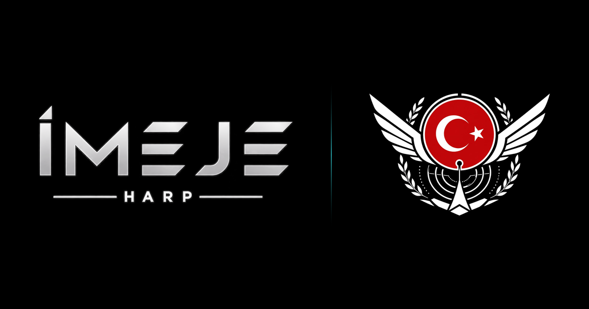
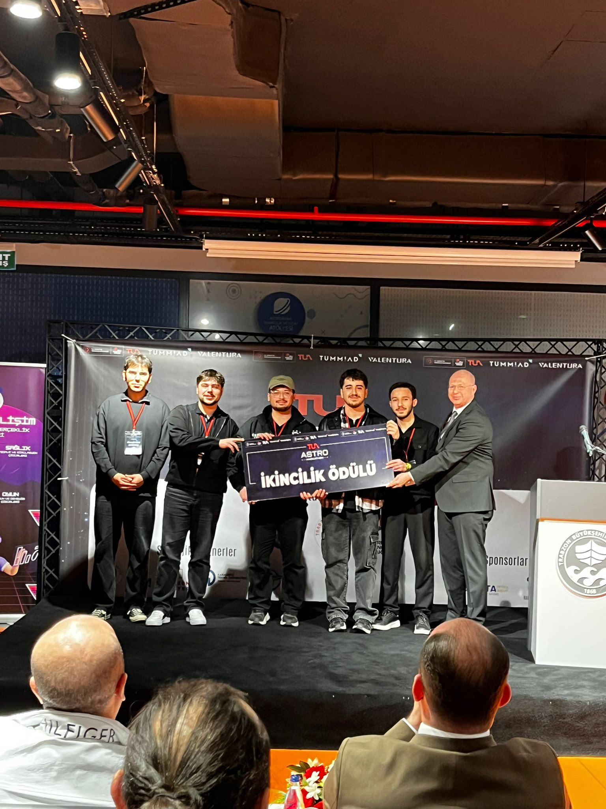
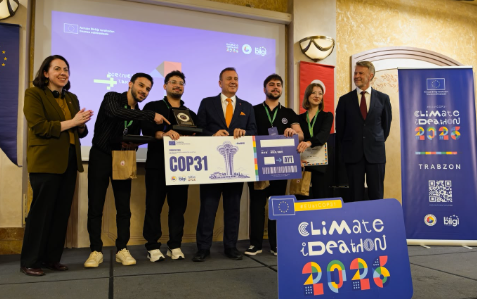

<div align="center">



<br>

### Bağımsız Öğrenci Mühendislik Takımı · Elektronik Harp Sistemleri

Takımın tek sayfa tanıtım sitesi — **BTK Akademi Yapay Zeka Eğitimi** kapsamında hazırlanmıştır.

<br>


**[🌐 imejeteam.com](https://imejeteam.com)** · **[📷 @imejeteam](https://www.instagram.com/imejeteam/)** · **[💼 LinkedIn](https://linkedin.com/company/imejeteam)** · **[✉️ imejeteam@gmail.com](mailto:imejeteam@gmail.com)**

</div>

---

## Bu site neden var?

Bu depo, **BTK Akademi Yapay Zeka Eğitimi** için hazırlanan bitirme çalışmasıdır. Eğitimde
öğrenilen üretken yapay zekâ ve istem mühendisliği yetkinlikleri, İMEJE takımını anlatan
gerçek bir ürüne dönüştürülerek uygulanmıştır.

Eğitim, Gençlik ve Spor Bakanlığı’nın yürüttüğü **GENÇ2030 — Dijital Yetkinlikler ve Yapay
Zekâ Atölyesi** programı kapsamındadır. Program 81 ildeki gençlik merkezlerini yapay zekâ
atölyelerine dönüştürmeyi ve 2030’a kadar 100 bin yapay zekâ girişimcisi yetiştirmeyi
hedefler; eğitim içerikleri BTK Akademi iş birliğiyle sağlanır.

## İMEJE kimdir?

Arda Öztürk liderliğinde, üniversitemizde yeterli teknik çalışma alanı bulunmaması üzerine
kendi çabalarıyla bir araya gelen ve kurduğu atölye imkânlarıyla doğrudan **askeri elektronik
harp sistemleri** geliştirmeye odaklanan bağımsız bir öğrenci mühendislik takımıdır.

Gazi Mustafa Kemal Atatürk’ün akıl ve bilimi rehber kılan vizyonunu temel alan ekip;
TEKNOFEST ve EFES Tatbikatı gibi platformlarda yer almayı, milli savunma teknolojilerine
atölye masasından somut katkı sunmayı hedefler.

> **“Pressure makes diamonds”** — çalışma kültürümüzün merkezindeki felsefe.

### Birim yapısı

| Birim | Sorumluluk | Yürütücü |
| :--- | :--- | :--- |
| **RF ve Aviyonik Sistemleri** | Yüksek frekans ve aviyonik mimariler | Naim Furkan Şahin |
| **Otonom Sistemler ve İstihbarat** | Yazılım ve taktik istihbarat sistemleri | Emirhan Harput · Osman Fadıl Eliyatkın |
| **EH Doktrin ve Araştırma** | Literatür, taktik doktrin, sistem analizi | Doğrudan yönetim |

### Başarılar

| Platform | Derece |
| :--- | :--- |
| TUA ASTRO Hackathon · Trabzon | 🥈 **İkincilik Ödülü** |
| Climate iDEAthon 2026 · Trabzon | 🥇 **MAVERA ile COP31 bölge birinciliği** |
| Protokol ziyareti | Takım masasında bakanlık düzeyinde proje tanıtımı |

<div align="center">




</div>

---

## Site hakkında

Tek sayfa, kaydırmalı tanıtım sitesi. **Derleme adımı yok, bağımlılık yok, çerçeve yok** —
tek bir `index.html` içinde HTML, CSS ve sade JavaScript.

**Bölümler:** Kimlik · Takım görselleri · Vizyon · Birim yapısı · Başarılar · BTK Akademi ve GENÇ2030 · İletişim

| Özellik | Açıklama |
| :--- | :--- |
| 🌗 **Açık / koyu tema** | Ziyaretçinin cihaz temasına göre otomatik |
| 📱 **Mobil uyumlu** | Açılır menü, galeride parmakla kaydırmalı şerit |
| 📲 **Ana ekrana eklenebilir** | `manifest.webmanifest` ile uygulama gibi açılır |
| 🔗 **Paylaşım kartı** | WhatsApp ve sosyal medyada logolu önizleme |
| ♿ **Erişilebilir** | Klavye odağı, görsel alternatif metinleri, hareket azaltma desteği |

### Dosya yapısı

```
index.html             tüm sayfa — HTML + CSS + JS
manifest.webmanifest   mobilde "ana ekrana ekle" tanımı
images/                takım fotoğrafları, arma ve ikonlar
```

### Çalıştırma

```bash
git clone https://github.com/ardaztrk05/btkimeje.git
cd btkimeje
```

`index.html` dosyasını tarayıcıda aç — kurulum gerekmez.

### Yayınlama

Statik site olduğu için Vercel'de ayar gerektirmez:

1. **vercel.com → Add New → Project →** `btkimeje` reposunu içe aktar
2. Framework Preset **Other**, Build Command ve Output Directory boş
3. **Deploy**

> [!IMPORTANT]
> Paylaşım kartı mutlak adres kullanır. Yayın adresi değişirse `index.html` içindeki
> `og:url`, `og:image` ve `twitter:image` değerlerini gerçek alan adıyla güncelle.
> Tanımlı adres: `https://btkimeje.vercel.app/`
> WhatsApp önizlemeyi önbelleğe alır; güncelledikten sonra linkin sonuna `?v=2` ekleyerek test et.

---

<div align="center">


**İMEJE** · Bağımsız Öğrenci Mühendislik Takımı

<sub>BTK Akademi Yapay Zeka Eğitimi · GENÇ2030</sub>

</div>
